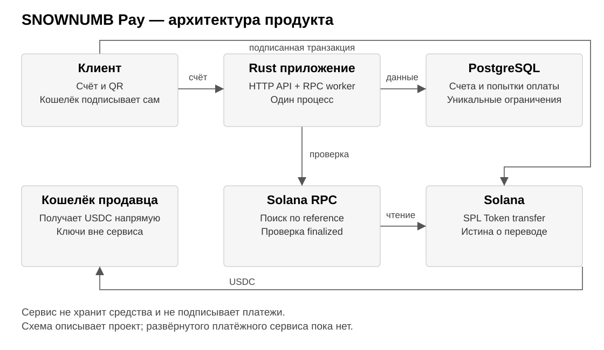
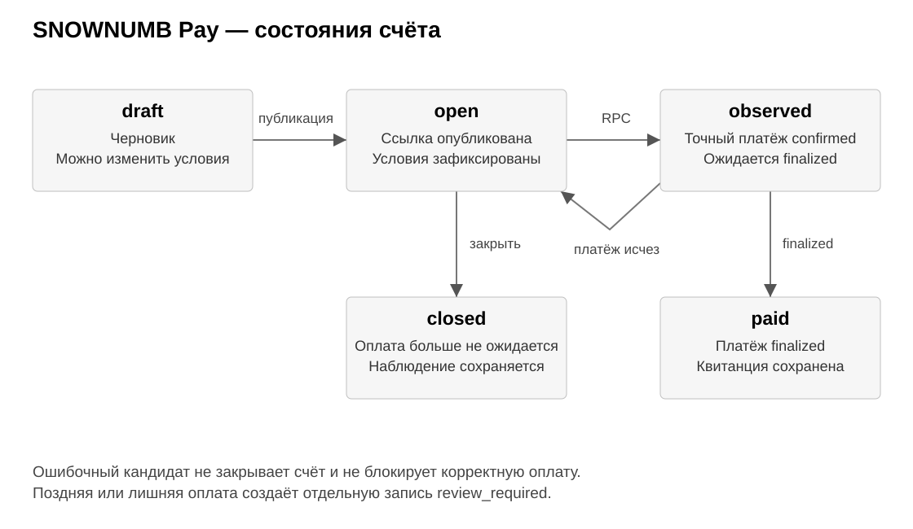

# SNOWNUMB Pay

**Проект оплаты счетов в USDC на Solana**

Спроектировал SNOWNUMB Pay — сервис выставления и оплаты счетов в USDC для фрилансеров и небольших студий. Деньги поступают напрямую в кошелёк продавца, а сервис связывает перевод со счётом и проверяет его через Solana RPC. Результат задания 13 — спецификация продукта, архитектура, модель данных и критерии приёмки. На этапе проектирования платёжный сервис и переводы не запускались.

## 1 Продукт и сценарий

Продавец отправляет клиенту ссылку на счёт за цифровую услугу. Клиент видит сумму, сеть и получателя, проверяет их в кошельке и подписывает перевод. Продавец получает подтверждение конкретного счёта вместо ручного поиска платежа в истории общего кошелька.

<table align="center">
  <thead><tr><th align="center" valign="middle">Участник</th><th align="center" valign="middle">Задача</th><th align="center" valign="middle">Что получает</th></tr></thead>
  <tbody>
    <tr><td align="center" valign="middle">Фрилансер или студия</td><td align="center" valign="middle">Создать счёт и принять оплату</td><td align="center" valign="middle">Статус и квитанцию по заказу</td></tr>
    <tr><td align="center" valign="middle">Заказчик</td><td align="center" valign="middle">Оплатить согласованную сумму</td><td align="center" valign="middle">Понятные реквизиты и статус</td></tr>
    <tr><td align="center" valign="middle">Сервис</td><td align="center" valign="middle">Сопоставить счёт с переводом</td><td align="center" valign="middle">Проверенную запись платежа</td></tr>
  </tbody>
</table>

Основной сценарий: продавец создаёт счёт на 125.50 USDC; сервис фиксирует реквизиты и выдаёт ссылку с QR; клиент оплачивает её; RPC worker находит перевод и проверяет условия; после finalized формируется квитанция. Сумма в примере показывает проектное поведение, а не состоявшийся перевод.

В первую версию входят создание и закрытие счёта, публичная страница оплаты, журнал попыток и экспорт квитанции. Одна транзакция оплачивает один счёт. Автоматические частичные доплаты, обмен валют, банковские выплаты, мосты и хранение средств сервисом исключены.

Выбран stablecoin payment из вариантов задания. Собственный стейблкоин и токенизация реального актива не нужны для приёма оплаты за услуги. SNTOK из предыдущих заданий сохраняется и не объявляется стейблкоином. Платная подписка за журнал и экспорт — продуктовая гипотеза; сетевую комиссию и создание ATA оплачивает плательщик в SOL.

## 2 Архитектура и границы доверия

Один Rust-процесс обслуживает HTTP API и фоновую сверку RPC. Веб-страницы используют HTML, CSS и JavaScript по существующему подходу dashboard-client. PostgreSQL предлагается для постоянного хранения счетов и защиты от повторного зачёта. Это целевая архитектура: новые зависимости и runtime пока не добавлены.

Кошелёк клиента подписывает перевод; кошелёк продавца принимает USDC. Сервер хранит публичные реквизиты, но не seed phrase или приватные ключи. Подпись транзакции от браузера служит подсказкой для поиска, а право отметить счёт оплаченным принадлежит только RPC worker.

<table align="center">
  <thead><tr><th align="center" valign="middle">Решение</th><th align="center" valign="middle">Причина</th><th align="center" valign="middle">Принятый компромисс</th></tr></thead>
  <tbody>
    <tr><td align="center" valign="middle">Стандартный SPL-перевод</td><td align="center" valign="middle">Не требуется новый контракт</td><td align="center" valign="middle">Ссылка не запрещает поздний платёж</td></tr>
    <tr><td align="center" valign="middle">Один процесс и PostgreSQL</td><td align="center" valign="middle">Достаточно для начального продукта</td><td align="center" valign="middle">Ограничение масштабирования одного узла</td></tr>
    <tr><td align="center" valign="middle">paid только после finalized</td><td align="center" valign="middle">Квитанция опирается на финальное состояние</td><td align="center" valign="middle">Подтверждение занимает дополнительное ожидание</td></tr>
  </tbody>
</table>

Из текущего проекта переиспользуются идеи точных целых сумм, канонического ATA, проверки сети и ограниченных RPC-запросов. DeFi и compose_transfer не включаются в платёжный путь: операции из заданий 9–11 не заменяют сверку счёта.

## 3 Платёжный контракт

Каждый опубликованный счёт фиксирует network, mint, token_program, merchant_wallet, recipient_ata, amount_raw и уникальный reference. Изменить реквизиты открытого счёта нельзя: продавец закрывает его и создаёт новый. Условия берутся из сохранённой записи сервера, а не из параметров запроса клиента.

<table align="center">
  <thead><tr><th align="center" valign="middle">Параметр</th><th align="center" valign="middle">Проектное значение</th></tr></thead>
  <tbody>
    <tr><td align="center" valign="middle">Актив и точность</td><td align="center" valign="middle">USDC; ожидается 6 decimals с обязательной проверкой mint через RPC</td></tr>
    <tr><td align="center" valign="middle">Сумма примера</td><td align="center" valign="middle">125.50 USDC = 125500000 минимальных единиц</td></tr>
    <tr><td align="center" valign="middle">Devnet mint</td><td align="center" valign="middle">4zMMC9srt5Ri5X14GAgXhaHii3GnPAEERYPJgZJDncDU</td></tr>
    <tr><td align="center" valign="middle">Mainnet mint</td><td align="center" valign="middle">EPjFWdd5AufqSSqeM2qN1xzybapC8G4wEGGkZwyTDt1v</td></tr>
    <tr><td align="center" valign="middle">Token Program</td><td align="center" valign="middle">TokenkegQfeZyiNwAJbNbGKPFXCWuBvf9Ss623VQ5DA</td></tr>
  </tbody>
</table>

В Solana Pay transfer request путь recipient содержит адрес кошелька продавца, а spl-token — mint. amount передаётся десятичной строкой пользовательских единиц: 125.50. reference — случайный 32-байтовый идентификатор в base58, уникальный для счёта, включённый в инструкцию перевода как read-only non-signer.

Внутренний расчёт использует целые минимальные единицы и BIGINT; HTTP API передаёт amount_raw строкой. Float, отрицательные суммы, ноль, экспоненциальная запись и дробь точнее decimals отклоняются. Базовый продукт ограничивает значение диапазоном положительного BIGINT.

Сеть не добавляется вымышленным параметром cluster в Solana Pay URI. Она фиксируется в счёте, показывается на странице и проверяется сервером по genesis hash RPC; кошелёк должен быть в той же сети. Контуры devnet и mainnet разделены. Devnet USDC не имеет денежной стоимости; основная сеть требует отдельного включения конфигурации.

Имя клиента и текст заказа хранятся вне блокчейна. Публичная страница раскрывает только необходимые реквизиты. Memo не используется для персональных данных. USDC выбран как расчётный актив; его курс, доступность и ограничения эмитента не контролируются сервисом.

## 4 Состояния и обработка сбоев

draft допускает редактирование; open выдаёт неизменяемую платёжную ссылку. observed означает обнаружение точного корректного перевода с confirmed. Только повторная проверка finalized переводит счёт в paid и создаёт квитанцию. При исчезновении кандидата observed возвращается в open, если счёт не закрыт.

closed означает, что сервис больше не предлагает оплату. Обычный SPL-перевод остаётся возможен, поэтому сканирование закрытых счетов продолжается с возможностью полной повторной сверки. Поздняя оплата получает review_required и не создаёт квитанцию автоматически. При неоднозначности закрытия и подтверждения применяется тот же порядок.

Неполная сумма, переплата и лишний перевод сохраняются отдельными попытками и требуют решения продавца. Чужой mint, неверный адрес или ложная подпись отклоняются как кандидаты и не блокируют счёт. Повтор уже известной подписи не создаёт новую оплату; новая подпись для paid сохраняется как лишний платёж.

Возврат — отдельный перевод, который продавец проверяет и подписывает своим кошельком. Сервис не возвращает средства автоматически по адресу из запроса клиента. Для учёта сохраняются получатель, сумма и проверенная подпись возврата; история исходного платежа остаётся неизменной.

При недоступности RPC статус не повышается. Worker повторяет чтение с ограничением частоты и сохраняет курсор после фиксации результатов. После перезапуска он просматривает необработанный диапазон, включая платежи, пришедшие во время остановки.

## 5 Данные и интерфейсы

<table align="center">
  <thead><tr><th align="center" valign="middle">Сущность</th><th align="center" valign="middle">Основные поля и ограничения</th></tr></thead>
  <tbody>
    <tr><td align="center" valign="middle">Merchant</td><td align="center" valign="middle">id, учётная запись, verified_wallet; изменение кошелька только после подтверждения владения</td></tr>
    <tr><td align="center" valign="middle">Invoice</td><td align="center" valign="middle">id, public_id, merchant_id, network, mint, token_program, merchant_wallet, recipient_ata, decimals, amount_raw, reference, state, version</td></tr>
    <tr><td align="center" valign="middle">PaymentAttempt</td><td align="center" valign="middle">network, signature, invoice_id, slot, outcome, reason; UNIQUE(network, signature)</td></tr>
    <tr><td align="center" valign="middle">Receipt</td><td align="center" valign="middle">invoice_id UNIQUE, payment_attempt_id UNIQUE, amount_raw, mint, recipient_ata, finalized_slot</td></tr>
    <tr><td align="center" valign="middle">Refund и ScanCursor</td><td align="center" valign="middle">Проверенный возврат и позиция сканирования; не меняют исходную квитанцию</td></tr>
  </tbody>
</table>

Кошелёк продавца подтверждается подписью одноразового сообщения с nonce, доменом и назначением запроса. Сервис отклоняет использованный challenge и не принимает подпись транзакции вместо подтверждения владения. Опубликованные счета сохраняют снимок старого адреса при смене кошелька продавца.

У Invoice задаются UNIQUE(network, reference) и CHECK(amount_raw > 0). Публичный public_id непредсказуем. Проверка доступа выполняется по merchant_id из серверной сессии; клиент не выбирает чужого продавца. API создания использует Idempotency-Key, связанный с продавцом и хешем тела: одинаковый запрос возвращает тот же счёт, изменённое тело — конфликт.

<table align="center">
  <thead><tr><th align="center" valign="middle">Предлагаемый endpoint</th><th align="center" valign="middle">Назначение и доступ</th></tr></thead>
  <tbody>
    <tr><td align="center" valign="middle">POST /api/invoices</td><td align="center" valign="middle">Создать draft; авторизованный продавец</td></tr>
    <tr><td align="center" valign="middle">POST /api/invoices/{id}/publish</td><td align="center" valign="middle">Зафиксировать условия и reference; владелец</td></tr>
    <tr><td align="center" valign="middle">POST /api/invoices/{id}/close</td><td align="center" valign="middle">Закрыть только open; владелец; проверка version</td></tr>
    <tr><td align="center" valign="middle">GET /pay/{public_id}</td><td align="center" valign="middle">Показать сумму, сеть, получателя и QR; публично</td></tr>
    <tr><td align="center" valign="middle">GET /api/payments/{public_id}</td><td align="center" valign="middle">Показать ограниченный статус; без данных клиента</td></tr>
    <tr><td align="center" valign="middle">GET /api/invoices/{id}/receipt</td><td align="center" valign="middle">Получить квитанцию после paid; владелец</td></tr>
  </tbody>
</table>

Верификация и обновление выполняются одной транзакцией БД с блокировкой строки Invoice: записать попытку, занять единственную квитанцию, изменить состояние. При повторной обработке существующая PaymentAttempt обновляется от observed к finalized или failed; конфликт уникальности не прекращает сверку. Повтор worker безопасен из-за уникальных ограничений. Отдельного endpoint «отметить оплачено» у браузера нет.

## 6 Проверка платежа и приёмка

Worker ищет кандидатов через getSignaturesForAddress(reference) с пагинацией и читает getTransaction. Параметр maxSupportedTransactionVersion соответствует возможностям декодера; проект предусматривает legacy, v0 и v1. Для v0 учитываются адреса lookup tables, для v1 — его собственный формат. Неизвестная версия и RPC null не дают права выставить paid; совместимость SDK проверяется при реализации.

Для зачёта требуются finalized, meta.err = null, известный Token Program, правильные mint и ATA продавца, reference в нужной инструкции и точная сумма. Проверяются инструкции и изменение USDC-баланса получателя в метаданных именно этой транзакции. При создании ATA исходный ноль допустим только после подтверждения факта его создания; отсутствие метаданных не трактуется как ноль.

Разрешён один платёжный перевод с одним reference счёта, без вывода средств из ATA продавца и дополнительных переводов токенов в той же транзакции. Вспомогательные инструкции ограничены compute budget, созданием ATA и memo. Такая узкая форма исключает спорное распределение одной транзакции между несколькими счетами.

<table align="center">
  <thead><tr><th align="center" valign="middle">Контрольный случай</th><th align="center" valign="middle">Критерий приёмки</th></tr></thead>
  <tbody>
    <tr><td align="center" valign="middle">Точная оплата и finalized</td><td align="center" valign="middle">Одна квитанция; paid; сумма совпадает с счётом</td></tr>
    <tr><td align="center" valign="middle">Только confirmed или RPC null</td><td align="center" valign="middle">Квитанции нет; ожидание продолжается</td></tr>
    <tr><td align="center" valign="middle">Ошибочный mint, ATA или reference</td><td align="center" valign="middle">Кандидат не зачтён; счёт остаётся доступен</td></tr>
    <tr><td align="center" valign="middle">Повтор обработки одной подписи</td><td align="center" valign="middle">Счёт и квитанция не дублируются</td></tr>
    <tr><td align="center" valign="middle">Неполная, лишняя или поздняя оплата</td><td align="center" valign="middle">Отдельная запись для разбора; без автоматического возврата</td></tr>
    <tr><td align="center" valign="middle">Сбой и перезапуск worker</td><td align="center" valign="middle">Курсор восстановлен; платежи не пропущены</td></tr>
    <tr><td align="center" valign="middle">Два worker одновременно</td><td align="center" valign="middle">Уникальные ограничения разрешают только одну квитанцию</td></tr>
  </tbody>
</table>

Для реализации сначала нужны серверный модуль счетов и миграции, затем страница оплаты и RPC worker, после — проверка сценариев в devnet. Это перечень следующих инженерных шагов, а не отчёт об их выполнении. В задании завершено проектирование; программный код и действующие платежи не заявляются.
