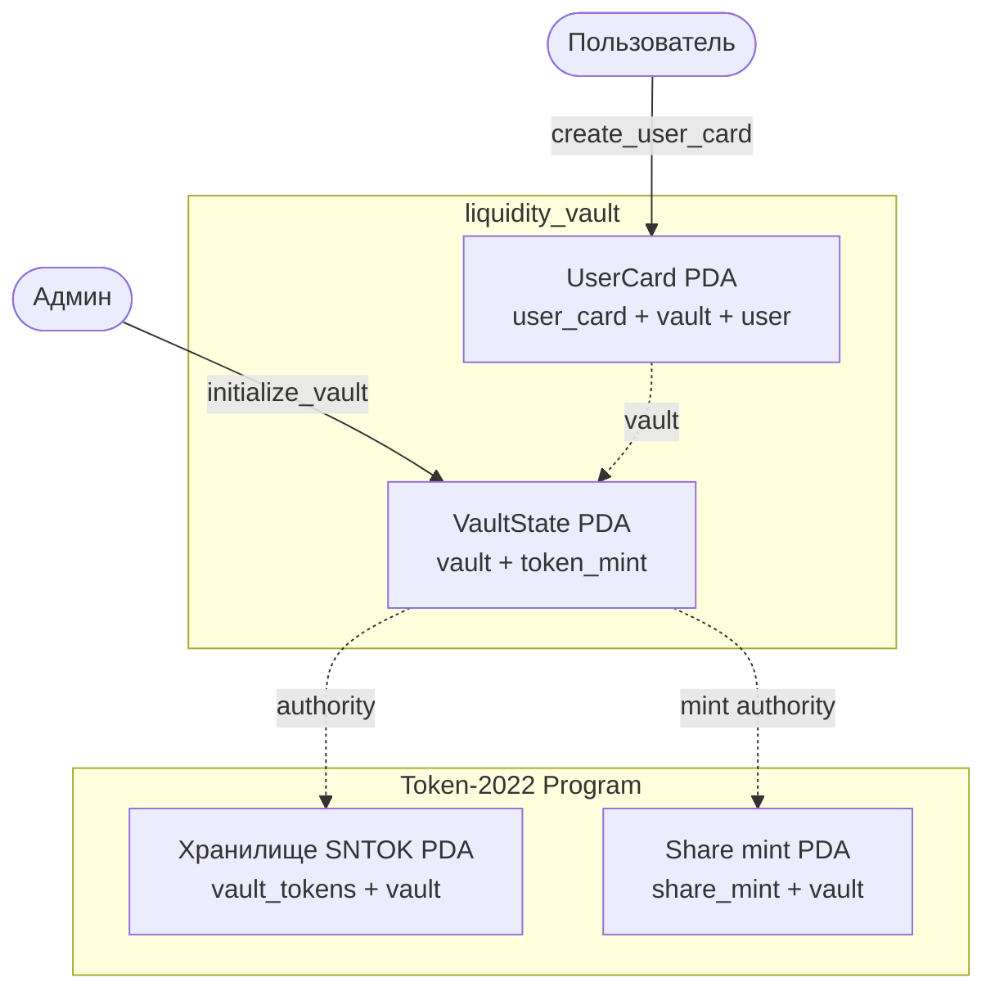

# Liquidity Vault (недели 8–13)

DeFi-vault на Anchor 1.1.2 и Rust. Пользователи вносят SNTOK в общее хранилище и получают share-токены — квитанцию о своей доле. Админ обменивает токены vault через собственный CLMM-пул Raydium и размещает их в позиции с выбранным диапазоном цен, где они получают комиссии с обменов. Токенами распоряжается только программа от имени PDA.

**Program ID (devnet):** [`3XvGNievhhJ9fX5SR46uK4TeBpuCYVV548WpzE5CnmAK`](https://explorer.solana.com/address/3XvGNievhhJ9fX5SR46uK4TeBpuCYVV548WpzE5CnmAK?cluster=devnet)

| Неделя | Тема | Подробности |
| :-- | :-- | :-- |
| 8 | каркас vault | [раздел](#неделя-8) |

## Структура и запуск

| Путь | Что внутри |
| :-- | :-- |
| [`programs/liquidity-vault/`](programs/liquidity-vault/) | Anchor-программа vault и тесты LiteSVM |
| [`clients/vault-client/`](clients/vault-client/) | Rust-клиент: команды vault, пула Raydium и позиции |

Папка — отдельный Cargo workspace. Все команды выполняются в терминале macOS zsh/bash из `liquidity-vault/`. Нужны Rust 1.89.0 и Solana CLI 3.1.10: SBF собирается `cargo-build-sbf` этой версии, сборка 4.x не исполняется в LiteSVM 0.10.

```bash
# Собрать программу, проверить формат, типы и тесты
~/.local/share/solana/install/releases/3.1.10/solana-release/bin/cargo-build-sbf --manifest-path programs/liquidity-vault/Cargo.toml
cargo fmt --all -- --check
cargo clippy --workspace --all-targets --locked -- -D warnings
cargo test --workspace --locked
```

```bash
# Список команд клиента
cargo run -p vault-client --locked -- --help
```

Клиент пишет только в devnet или localnet (проверка genesis), перед отправкой выполняет simulation и сверяет результат через RPC. По умолчанию используется кошелёк `../.keys/devnet-payer.json`; ключи и seed-фразы в репозиторий не попадают.


---

## Неделя 8

**Каркас vault**

Начинает **Liquidity Vault**: программа [`programs/liquidity-vault/`](programs/liquidity-vault/) принимает SNTOK пользователей в общее хранилище и выпускает share-токены — долю в нём. Rust-клиент [`clients/vault-client/`](clients/vault-client/) проверяет сеть по genesis (только devnet или localnet), выполняет simulation и читает результат через RPC.

**Program ID (devnet):** [`3XvGNievhhJ9fX5SR46uK4TeBpuCYVV548WpzE5CnmAK`](https://explorer.solana.com/address/3XvGNievhhJ9fX5SR46uK4TeBpuCYVV548WpzE5CnmAK?cluster=devnet). В devnet развёрнута сборка с инструкциями недель 8–13 под одним program ID; транзакции каждой недели вызывают только её инструкции.

### Схема аккаунтов



| Аккаунт | Seeds | Владелец аккаунта | Кто распоряжается | Что хранит |
| :-- | :-- | :-- | :-- | :-- |
| `VaultState` | `["vault", token_mint]` | программа vault | только программа | admin, token mint, token program, хранилище, share mint, `total_deposited`, bump |
| Хранилище | `["vault_tokens", vault]` | Token-2022 Program | `VaultState` (authority) | внесённые SNTOK |
| Share mint | `["share_mint", vault]` | Token-2022 Program | `VaultState` (mint authority) | share-токены, 6 decimals как у SNTOK |
| `UserCard` | `["user_card", vault, user]` | программа vault | пользователь создаёт свою | vault, owner, `deposited`, `created_at`, bump |

Хранилищем и share mint распоряжается `VaultState` — PDA без приватного ключа. Подписать за него может только программа, поэтому ни админ, ни пользователь не заберут токены и не выпустят share-токены своей подписью. Все инструкции работают через `token_interface`: vault принимает и SPL Token, и Token-2022.

### Запуск vault

В терминале macOS zsh/bash из папки `liquidity-vault/`. SBF собирается `cargo-build-sbf` из Solana 3.1.10: сборка 4.x не исполняется в LiteSVM 0.10.

```bash
# Собрать программу и проверить её в LiteSVM
~/.local/share/solana/install/releases/3.1.10/solana-release/bin/cargo-build-sbf --manifest-path programs/liquidity-vault/Cargo.toml
cargo test -p liquidity-vault -p vault-client --locked
```

```bash
# Создать vault для SNTOK, свою карточку и прочитать состояние
cargo run -p vault-client --locked -- init
cargo run -p vault-client --locked -- card
cargo run -p vault-client --locked -- show
```

По умолчанию клиент использует devnet, кошелёк `../.keys/devnet-payer.json` и mint SNTOK; `--url`, `--keypair` и `--mint` меняют их. Повторный `init` или `card` не создаёт дубликат, а показывает существующие аккаунты.

### Аккаунты в devnet

| Что | Ссылка |
| :-- | :-- |
| Программа | [3XvG…mAK](https://explorer.solana.com/address/3XvGNievhhJ9fX5SR46uK4TeBpuCYVV548WpzE5CnmAK?cluster=devnet) |
| VaultState | [6k3E…eACp](https://explorer.solana.com/address/6k3EuoscnFuHwswqPxjhR28h9mAc75HkenhmcZmyeACp?cluster=devnet) |
| Хранилище SNTOK | [54zx…P9No](https://explorer.solana.com/address/54zxzWPstT9rmqtJmbbyyVYVBwpDQZxGbJwbyWK8P9No?cluster=devnet) |
| Share mint | [7wZX…Rjfe](https://explorer.solana.com/address/7wZXDcPC4LX7cg2cxtYCViGnMrBB7zHBHvaUPzyRRjfe?cluster=devnet) |
| Карточка пользователя | [98QR…qwWQ](https://explorer.solana.com/address/98QRYEXEsayEdn3BXHi5tRWwH1HwG9DZRzxmAXmuqwWQ?cluster=devnet) |
| Транзакция `initialize_vault` | [AzAh…VfX](https://explorer.solana.com/tx/AzAhUFPe6BZvxYg9ay15AQpkmhK4rWkG6zFQcduH9tG73HvrAek2dycDTFSZuvQm7di6XuaMjSnU7u5ZCkarVfX?cluster=devnet) |
| Транзакция `create_user_card` | [4pMT…pzs5](https://explorer.solana.com/tx/4pMTngMDzSsdckNZd7SrqCwsk65GatBam9vWrmYN3VGqgJJARhLEZTf9Ke3MUmgBgvmYTRZjNceLyFz5FtKvpzs5?cluster=devnet) |

### Проверьте себя

- **Почему share-токен выпускает программа, а не администратор?** Mint authority — `VaultState` PDA. Программа выпускает share-токены только по правилам депозита; иначе админ напечатал бы себе долю и забрал чужие токены.
- **Что такое PDA и почему у неё нет приватного ключа?** Адрес выводится из seeds и program ID так, что он не лежит на кривой Ed25519. Ключа нет, подпись даёт только программа через `invoke_signed`.
- **Как найти карточку конкретного пользователя?** Вычислить PDA `["user_card", vault, user]`; список пользователей хранить не нужно.
